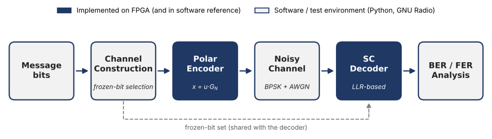

# FPGA Implementation of Polar Codes

**Project #3690 · School of Electrical Engineering, Tel Aviv University**

| | |
|---|---|
| **Students** | Tomer Eliel, Daniel Vasilnizky |
| **Supervisor** | Baruch Kagan |
| **Hosted at** | Ayeca Communication Systems Ltd. |
| **Platform** | iWave iW-RainboW-G30 (AMD Zynq UltraScale+ MPSoC) |
| **Code** | N = 1024, K = 512 (rate ½), BPSK over AWGN, SC decoding |

> This README is the project's working plan (v3), converted from the original Hebrew document.

---

## Table of Contents

1. [Abstract](#1-abstract)
2. [Motivation](#2-motivation)
3. [Scope of Work](#3-scope-of-work)
4. [Deliverables](#4-deliverables)
5. [Schedule](#5-schedule)
6. [References](#references)

---

## 1. Abstract

This project covers the research, design and implementation of **polar codes**, a family of error-correcting codes.

Polar codes are a breakthrough in information theory: they are the first codes mathematically proven to **achieve channel capacity (Shannon capacity)** on symmetric binary-input memoryless channels. Their low encoding and decoding complexity also makes them practical for a wide range of applications, most notably **5G**, where the control channels are encoded with polar codes.

We will build a full simulation of the communication chain, including channel construction, encoding and decoding. A main goal is to implement the code **in hardware (FPGA) and in software separately**, and to compare the two implementations to find out which is the more efficient way to implement it.

We will study polar-code performance in theory and in simulation over different noise types (for example, the AWGN channel) to understand which applications polar coding suits.

*Figure 1: Block diagram of the communication chain and the split between the hardware implementation and the software environment.*

Performance is measured with the metrics in [Section 4.3](#43-quantitative-system-requirements): bit/block error rate vs. SNR, latency and power.

## 2. Motivation

5G networks must support **ultra-reliable, very low-latency** communication. Many applications depend on this, including autonomous vehicles, medicine, industrial automation and defense. The control channels in these networks carry control messages with **short block lengths**, and at such lengths polar codes are the fastest and most reliable option. The engineering goal of the project is to research and implement an optimal solution for carrying these messages, comparing a hardware implementation with a software one.

Existing alternatives:

- **LDPC codes** perform very well on long blocks, but their performance degrades on short blocks.
- **Turbo codes** were used in earlier cellular generations. They perform well, but decoding is relatively complex, uses a lot of silicon and power, and has relatively high latency.

## 3. Scope of Work

### 3.1 Theoretical Background and Sources

We will first study the mathematical background of polar codes. The main source is Erdal Arıkan's landmark 2009 paper [[1]](#references), which requires familiarity with Markov chains, transformation matrices and error-probability calculations.

### 3.2 Implementation Methods and Stages

1. **Code construction:** an algorithm that computes the reliability of the synthesized channels. For erasure channels (BEC) we will implement an exact recursive algorithm. For Gaussian channels we will use statistical approximations, such as Monte Carlo, to choose the good channels.
2. **Encoding:** an encoder that takes an information vector and a frozen-bit vector and runs the recursive process described in the paper, by multiplying with the transformation matrix.
3. **Channel:** simulations of transmission over the noisy channel.
4. **Decoding:** a **Successive Cancellation (SC)** decoder that runs a serial recursive computation over the decoding tree. Each bit is estimated using the decisions made for the bits before it.
5. **Testing and performance analysis:** testbenches for the implementations, and analysis of the data they produce to evaluate performance.

### 3.3 Tools and Languages

- **Software implementation:** Python, with libraries such as NumPy.
- **Hardware implementation:** FPGA, in a Linux-based development environment, learning the Verilog hardware description language.
- **Development environments:** Vivado for synthesis, implementation and RTL simulation. GNU Radio for the software communication chain.
- **Auxiliary tools:** possibly MATLAB for plots and extra simulations.

## 4. Deliverables

Deliverables come in two stages: **interim deliverables**, shown in the mid-project presentation, and **final deliverables**, shown in the poster and the project book. Each deliverable has a practical part (code, design or a working system) and a document describing it.

### 4.1 Deliverables by the Mid-Project Presentation

1. **Python simulation:** a full software implementation of the communication chain: frozen-bit selection, encoder, BPSK modulation, AWGN channel and SC decoder. It will produce **BER/FER vs. SNR** plots that serve as the baseline for later comparisons.
2. **GNU Radio communication chain:** the full chain built in GNU Radio. This is the software implementation the FPGA implementation will be compared against.
3. **Requirements document:** choice of code parameters (block length and code rate) and noise type, definition of the quantitative system requirements ([Section 4.3](#43-quantitative-system-requirements)), and the test plan.
4. **System design document:** comparison of several ways to implement the decoder in hardware and selection of the best one, the hardware/software split, and analysis of how many bits are needed to represent numbers in hardware without hurting performance.
5. **Work environment and first hardware modules:** a Linux environment with Vivado, GNU Radio and Python, and a first Verilog implementation of the encoder and the decoder building blocks, verified in simulation.

### 4.2 Final Deliverables

1. **Working FPGA system:** a polar encoder and decoder running on the FPGA board, connected to a PC that sends data to the board and receives the results.
2. **Automated test software:** a Python script that runs the system over many configurations (different code lengths and noise levels), compares the results to the simulation, and produces a summary report.
3. **Measurement tools:** modules that help measure the system, for example counters that time decoding, and Vivado tools for observing internal signals at run time.
4. **Results analysis document:** measurements vs. requirements ([Section 4.3](#43-quantitative-system-requirements)), a comparison of the hardware and software implementations, and conclusions.

### 4.3 Quantitative System Requirements

The requirements are defined for a code of length **N = 1024** bits, of which **K = 512** are information bits (code rate ½), with **BPSK** modulation, an **AWGN** channel and an **SC** decoder. The system will be implemented on the **iW-RainboW-G30** board, built around an AMD **Zynq UltraScale+** chip that combines an FPGA fabric and ARM processors on the same die.

| # | Topic | What is measured | Target | How it is measured |
|---|---|---|---|---|
| 1 | Error correction | Performance loss of the hardware implementation vs. the simulation (at FER = 10⁻³) | ≤ 0.25 dB | Comparing hardware and simulation BER/FER curves |
| 2 | Throughput | Information bits decoded per second | To be set in the requirements document: ≥ 5 Mbps at a 100 MHz clock | Hardware clock-cycle counting and Vivado reports |
| 3 | Latency | Time to decode one codeword | To be set in the requirements document: ≤ 100 µs | Clock-cycle count from data reception to output |
| 4 | FPGA resources | Chip resources used by the system (LUT, FF, BRAM, DSP) | ≤ 30% of each resource type | Vivado utilization report |
| 5 | Power and energy | Energy per decoded bit, and power vs. clock frequency, for the hardware and for the on-board ARM | To be set after measuring the software implementation on the on-board ARM | Vivado power report and measurement on the on-board processor |
| 6 | Correctness | Full match between the hardware output and the simulation output | 100%, over at least one million codewords | Automatic comparison in the test software |

> The values in the table are initial targets, based on the literature and preliminary estimates. Final values will be set in the requirements document, planned for **2026-12-29**, after running the simulations. They may also be updated later in the project according to the chosen implementation, board limits and measurement results. Every change will be documented and coordinated with the supervisor.

### 4.4 Test Methods and Test Environment

The Python simulation serves as the **golden reference**: it generates input data and expected results, and every part of the implementation is checked against it.

- **Unit testing:** simulating each Verilog module in Vivado, feeding it data from the simulation and checking that the output matches the expected result.
- **On-board system testing:** the PC sends noisy data to the board, receives the decoded bits and compares them to the simulation results.
- **Performance measurement:** producing error-rate plots, and measuring throughput, latency, resources and power, then comparing them to the requirements table.
- **Comparison with the software implementation:** running the same data in GNU Radio and in Python, including on the board's ARM processor, and comparing results, speed and energy consumption.

## 5. Schedule

The schedule has **16 milestones**, following the work stages described in [Section 3](#3-scope-of-work). Mandatory milestones (mid-project presentation, poster and project completion) are in **bold**.

| # | Milestone | Details | Due date | Notes |
|---|---|---|---|---|
| 1 | Learning I | First look at polar codes: the polarization principle, encoding and decoding | 2026-11-10 | ✅ Done |
| 2 | Learning II | Deeper study of the math (Arıkan's paper), frozen-bit selection, the decoding algorithm and number representation in hardware | 2026-11-24 | |
| 3 | Work environment setup | Install Linux, Vivado, GNU Radio and Python, and open a shared Git repository | 2026-12-01 | |
| 4 | Getting to know the FPGA board | Read the board documentation and do basic exercises (blinking an LED, communicating with the PC) | 2026-12-15 | Material provided by the supervisor and the manufacturer's site |
| 5 | Python simulation | Full software implementation of the communication chain and error-rate plots | 2026-12-22 | Baseline for later comparison |
| 6 | Requirements document | Choose code parameters and noise type, define quantitative requirements and plan tests | 2026-12-29 | Includes choosing the noise type to focus on |
| 7 | GNU Radio communication chain | Build the chain in GNU Radio and check that it matches the simulation | 2027-01-05 | |
| 8 | System design | Compare decoder implementation options, choose one, and draw the system block diagram | 2027-01-15 | |
| 9 | First hardware modules | Write the encoder and decoder building blocks in Verilog and verify them in simulation | 2027-01-22 | |
| **10** | **Mid-project presentation** | **Present the background, simulation, GNU Radio chain, system design and first modules** | **2027-02-01** | 10 days to prepare the presentation |
| 11 | Full decoder implementation | Complete the decoder, connect it to the encoder, and verify in simulation that results match the Python simulation | 2027-03-15 | Core of the project, a lot of time allocated |
| 12 | Running on the board | Program the system onto the FPGA board, connect it to the PC and run the full chain | 2027-04-01 | |
| 13 | Testing and measurements | Run the automated tests and measure error rate, speed, resources and power | 2027-04-20 | Flexible, depending on when stage 12 ends |
| 14 | Results analysis | Write the analysis document: comparison to requirements and to the software implementation, and conclusions | 2027-05-04 | |
| **15** | **Poster submission and end of project work** | **Prepare the poster and present the working system and measurement results** | **2027-05-16** | |
| **16** | **Project book and final presentation submission** | **Write the project book and prepare the final presentation** | **2027-06-23** | About a month for writing |
| | Final presentation | | July–August 2027 | |

## References

1. E. Arıkan, "Channel Polarization: A Method for Constructing Capacity-Achieving Codes for Symmetric Binary-Input Memoryless Channels," *IEEE Trans. Inf. Theory*, vol. 55, no. 7, 2009.
2. E. Arıkan and G. Markarian, "Two-Dimensional Polar Coding," 2009.
3. C. Leroux et al., "A Semi-Parallel Successive-Cancellation Decoder for Polar Codes," *IEEE Trans. Signal Process.*, vol. 61, no. 2, 2013.
4. iWave Systems, "iW-RainboW-G30 Zynq UltraScale+ MPSoC Development Kit – User Manual."
